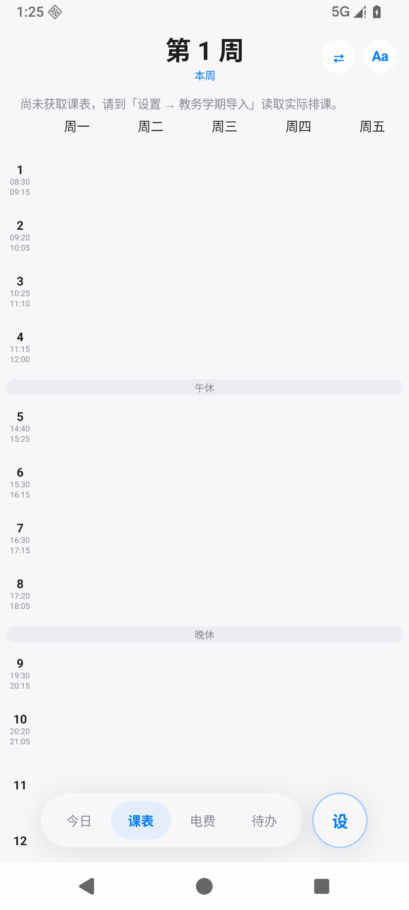
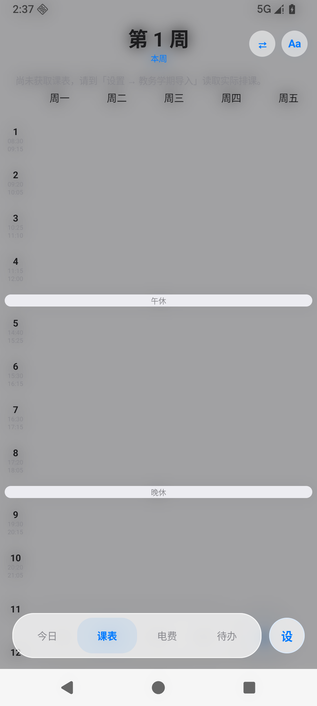
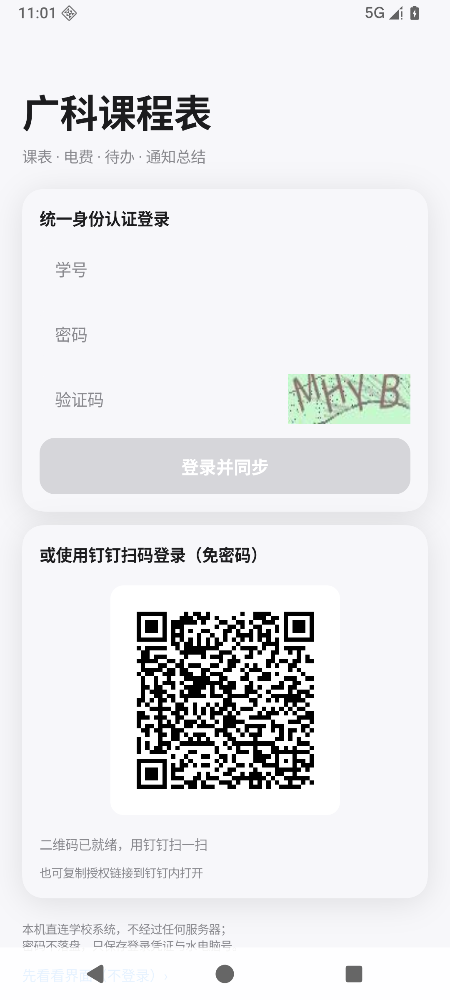

# 广科课程表

<p align="center">
  
  
  
</p>

广东科技学院专属课表 App —— 整学期课表导入 · 宿舍水电 · 待办 · AI 总结。所有数据由 App **本机直连**学校系统，无自建服务器、无账号体系、无遥测。

## 功能

- **整学期课表导入**：登录统一身份认证后直接读取正方教务系统，按每门课**实际周次**保存——支持分段周（`1-8周`、`14-17周`）、单双周、独立调课，不是"本周复制到全学期"
- **三种登录方式**：账号密码直连（票据自动续租）/ 钉钉扫码（SSE + App 自绘二维码，免验证码）/ 网页登录（兼容备用）。教务会话持久化，12 小时自动同步，失效才提醒重登
- **宿舍水电**：完美校园接口直连，剩余电量大字 + 今日/近 7 日/当月用量 + 走势图（点按查看任意采样点）+ 低电量/掉电速率双预警（后台 15 分钟巡检，同类 12h 冷却）
- **通知 AI 总结**：自填任意 OpenAI 兼容端点，把学校公告提炼成要点
- **桌面小组件 ×9**：课表数据（今日条子 4×2 / 下一节 2×2 / 周进度 1×2）、宿舍电量（走势+七天/半月切换 4×2 / 大字+迷你走势 2×2 / 竖条 1×2）、待办条子（列表 4×2 / 概览 2×2 / 计数 1×2），实底卡片，数据全部本机缓存，不打网络
- **CZeroX 界面**：实底卡片语言，可读性优先，App 与桌面小部件共用同一套色板与间距；组件体系基于 Miuix（Apache-2.0，部分 vendor 进源码）。早期版本曾移植 [NexioSchedule](https://github.com/HaoZai000/NexioSchedule) 的页面与玻璃底栏，CZeroX 改版已移除全部玻璃实现，移植记录保留在 [NOTICE.md](NOTICE.md)
- **更多**：莫奈动态取色、课表壁纸（模糊/压暗可调）、卡片字号/高度/圆角/对齐/文字颜色可调、点课程卡看详情、备份与恢复（SAF）、待办

## 隐私

- 登录凭证、CAS 票据、教务会话 Cookie 存本机**加密存储**（EncryptedSharedPreferences）；密码不落盘
- 备份文件不含登录凭证与密码
- 无自建服务器、无账号体系、无遥测；卸载即全部清除

## 技术栈

Kotlin · Jetpack Compose · Material 3 · [Miuix](https://github.com/miuix-kotlin-multiplatform/miuix)（Apache-2.0，部分 vendor 进源码）· Glance · WorkManager · OkHttp/OkHttp-SSE · ZXing · [MaterialKolor](https://github.com/jordond/MaterialKolor)（MIT）

## 构建

```bash
# JDK 21 + Android SDK 37（compileSdk）/ minSdk 33（Android 13+）
./gradlew assembleDebug
```

- 产物：`app/build/outputs/apk/debug/app-debug.apk`（纯 Kotlin/Compose，无 native 依赖）
- release 签名文件不入库：自建 `signing/gdust-v2-release.jks` 与 `signing/keystore.properties`（`storePassword` / `keyAlias` / `keyPassword`），`build.gradle.kts` 检测到后自动签名

## 数据来源

| 数据 | 来源 |
|---|---|
| 校历 / 本周课表 / 公告 | 学校门户 smart-admin-api |
| 整学期课表 | 正方教务（校园网内网 / 新教务公网 / WebVPN 三入口自动尝试） |
| 水电 | 完美校园智能水电接口 |
| AI 总结 | 用户自填的 OpenAI 兼容端点 |

## 协议

本项目以 **[GNU AGPL-3.0](LICENSE)** 发布：可自由使用、修改与分发，衍生作品须同样以 AGPL-3.0 开源；若作为网络服务提供，也必须向使用者提供对应源码。

历史版本曾移植 [NexioSchedule](https://github.com/HaoZai000/NexioSchedule)（AGPL-3.0）的界面实现，这些提交仍保留在 git 历史中并同样按 AGPL-3.0 提供；当前 CZeroX 界面为独立重写。第三方依赖与出处见 [NOTICE.md](NOTICE.md)。

> 本项目为个人学习项目，与广东科技学院官方无关；使用本 App 产生的账号、课表与水电数据均只保存在你自己的设备上。
