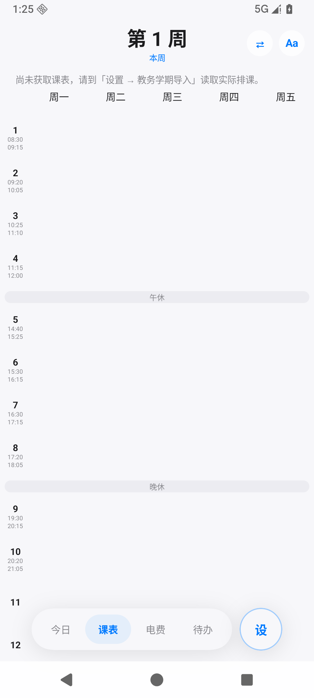

# 广科课程表

<p align="center">
  
  
  
</p>

广东科技学院专属课表 App —— 整学期课表导入 · 宿舍水电 · 待办 · AI 总结。所有数据由 App **本机直连**学校系统，无自建服务器、无账号体系、无遥测。

## 功能

- **整学期课表导入**：登录统一身份认证后直接读取正方教务系统，按每门课**实际周次**保存——支持分段周（`1-8周`、`14-17周`）、单双周、独立调课，不是"本周复制到全学期"
- **学校统一登录**：默认在学校网页完成一次认证，应用自动依次连接门户、教务和学习通，并分别验证业务会话；某一服务需要补充认证时停留在对应网页。旧账号/钉钉入口保留在兼容选项，票据只兑换一次、不再持久化重放；课表可选 12 小时自动同步
- **宿舍水电**：完美校园接口直连，剩余电量、历史走势与低电量/掉电预警；提供手动、均衡、低电量关注和自定间隔预设，按余量与近期用量调整查询节奏。前后台复用缓存与单次查询，无绑定或手动模式不运行电量后台任务；可用天数仅作粗估，同类预警 12h 冷却
- **学校通知**：按门户、教务处、官网来源手动刷新；切换来源复用缓存、刷新失败保留上次结果。教务处公开公告无需门户登录
- **身份隐私**：设置和个人信息默认遮罩姓名、学号，点按可展开；登录有效状态以在线身份校验为准
- **通知 AI 总结**：自填任意 OpenAI 兼容端点，把学校公告提炼成要点
- **上课勿扰**：在「设置 → 课程提醒」授权并开启，按本机课表上课启用、下课退出，允许闹钟；支持通知中的单次勿扰与取消本次。使用独立系统规则，保留手动勿扰和其他应用规则；未授予精确闹钟权限时边界切换可能延迟
- **学习通**：设置中统一为一个入口，主要操作为课程/任务进度和作业同步；连接帮助与详细诊断折叠展示。学校统一登录自动串联学习通，备用登录仍可使用；课程与作业按目标站点的实际会话读取，单课失败隔离，连接和同步结果分别展示
- **桌面个性化**：默认人物图标；可自定名称、选择图片并添加桌面快捷方式。安装标识固定为 `cn.edu.gdust.suiren`，与桌面显示独立
- **生日彩蛋**：从已认证教务的个人信息查询入口尝试读取出生日期，仅保存月日，生日当天显示一次去掉固定署名祝词的贺图；未取得明确日期则不触发，退出账号清除
- **学期日期滚轮**：学期设置与网页导入共用年／月／日选择，自动处理月底与闰年，确认第一周周一；学期设置可恢复跟随学校校历
- **桌面小组件 ×9**：课表数据（今日条子 4×2 / 下一节 2×2 / 周进度 1×2）、宿舍电量（走势+七天/半月切换 4×2 / 大字+迷你走势 2×2 / 竖条 1×2）、待办条子（列表 4×2 / 概览 2×2 / 计数 1×2），实底卡片、大字读数，按尺寸与系统字号调整信息量；App 内预览共用真实桌面布局。数据全部本机缓存，不打网络
- **CZeroX 界面**：实底卡片语言，可读性优先，App 与桌面小部件共用同一套色板与间距；组件体系基于 Miuix（Apache-2.0，部分 vendor 进源码）。早期版本曾移植 [NexioSchedule](https://github.com/HaoZai000/NexioSchedule) 的页面与玻璃底栏，CZeroX 改版已移除全部玻璃实现，移植记录保留在 [NOTICE.md](NOTICE.md)
- **更多**：莫奈动态取色、课表壁纸（模糊/压暗可调）、卡片字号/高度/圆角/对齐/文字颜色可调、点课程卡看详情、备份与恢复（SAF）、待办

## 隐私

- 门户登录凭证和直连教务 Cookie 存本机**加密存储**，网页会话由应用 WebView 保存；密码与一次性 CAS 票据不落盘。生日只保存月日，不保存出生年份或推算年龄
- 备份文件不含登录凭证与密码
- 无自建服务器、无账号体系、无遥测；卸载即全部清除

## 技术栈

Kotlin · Jetpack Compose · Material 3 · [Miuix](https://github.com/miuix-kotlin-multiplatform/miuix)（Apache-2.0，部分 vendor 进源码）· Glance · WorkManager · OkHttp/OkHttp-SSE · ZXing · [MaterialKolor](https://github.com/jordond/MaterialKolor)（MIT）

## 构建

```bash
# JDK 21 + Android SDK 37（compileSdk）/ minSdk 33（Android 13+）
./gradlew assembleDebug
```

- 产物：`app/build/outputs/apk/debug/app-debug.apk`（纯 Kotlin/Compose，无 native 依赖）
- release 签名文件不入库：自建 `signing/gdust-v2-release.jks` 与 `signing/keystore.properties`（`storePassword` / `keyAlias` / `keyPassword`），`build.gradle.kts` 检测到后自动签名
- alpha.22 安装标识为 `cn.edu.gdust.suiren`，与旧版 `com.menglimi.gdust.v2`、alpha.21 的 `cn.edu.gdust.course` 是独立应用。升级前可在旧版导出备份，新版导入课表、待办和偏好；登录会话、权限、桌面小部件及快捷方式需重新配置，生日月日不进入备份。

## 数据来源

| 数据 | 来源 |
|---|---|
| 校历 / 本周课表 / 公告 | 学校门户 smart-admin-api |
| 整学期课表 | 正方教务（校园网内网 / 新教务公网 / WebVPN 三入口自动尝试） |
| 水电 | 完美校园智能水电接口 |
| AI 总结 | 用户自填的 OpenAI 兼容端点 |

## 协议

本项目以 **[GNU AGPL-3.0](LICENSE)** 发布：可自由使用、修改与分发，衍生作品须同样以 AGPL-3.0 开源；若作为网络服务提供，也必须向使用者提供对应源码。

Copyright (C) 2026 suiren0219

历史版本曾移植 [NexioSchedule](https://github.com/HaoZai000/NexioSchedule)（AGPL-3.0）的界面实现，这些提交仍保留在 git 历史中并同样按 AGPL-3.0 提供；当前 CZeroX 界面为独立重写。第三方依赖与出处见 [NOTICE.md](NOTICE.md)。

> 本项目为个人学习项目，与广东科技学院官方无关；使用本 App 产生的账号、课表与水电数据均只保存在你自己的设备上。
