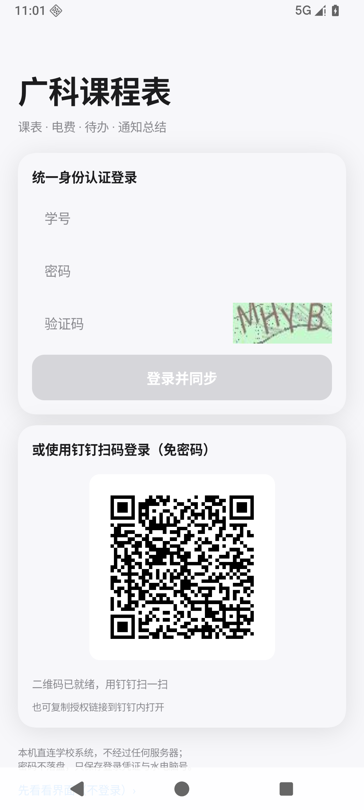

# 广科课程表

面向广东科技学院学生的开源 Android 应用，提供课表、校园服务、宿舍电量和待办。项目由个人维护，与学校官方无关。学校信息以官网为准。[广东科技学院官网](https://www.gdust.edu.cn/)

## 下载

从 GitHub Releases 查看已发布的 APK。开发中的功能以各 PR 为准。[下载与版本说明](https://github.com/suiren0219/gdust-v2/releases)

## 功能

| 功能 | 说明 |
| --- | --- |
| 课表与教务 | 导入整学期课表，保留实际周次、单双周和独立调课。支持成绩查看、课程提醒及课表自动同步。 |
| 校园服务 | 查看校历与公告，通过学校认证或网页入口连接教务和学习通。 |
| 宿舍电量 | 查询余量和近期用电，查看本机趋势与历史。后台自动采集默认关闭，开启后可记录采样并发送低电量、异常掉电预警。采样时机受 Android 后台调度影响。 |
| 待办 | 手动记录事项并设置到期提醒。获得通知使用权并开启功能后，可以从学习通推送提取待办。 |
| 桌面小部件 | 课表、电量、待办各有三种尺寸。小部件平时展示本机缓存，点击电量小部件的刷新按钮可主动查询。 |
| 公告总结 | 可选功能，使用你配置的 OpenAI 兼容服务处理公告。 |

以下截图来自历史版本，实际页面随版本调整。

<p align="center">
  
  
  
</p>

## 数据与隐私

- 应用直连学校门户、正方教务、学习通和完美校园。项目没有自建账号系统或遥测服务。
- 原生登录流程将会话凭证存入本机加密存储，密码不写入应用存储。应用内网页登录使用 Android WebView 管理网页会话。
- 备份可能包含课表、待办、电量历史和宿舍绑定信息，分享前请检查内容。导出文件不包含学校登录密码或会话凭证。
- 使用 AI 总结时，公告内容会发往你配置的服务。

## 本地开发

准备 JDK 21、Gradle 9.7.1 和 Android SDK 37。最低运行版本为 Android 13（API 33）。仓库未附带 Gradle Wrapper，请使用本机 Gradle。

```bash
gradle :app:testDebugUnitTest :app:assembleDebug
```

Debug APK 位于 `app/build/outputs/apk/debug/app-debug.apk`。构建环境、源码入口和验收方法见开发指南。[开发指南](docs/EXTENDING.md)

## 许可

项目采用 GNU AGPL-3.0。第三方代码的来源、版本与许可见出处说明。[LICENSE](LICENSE) · [NOTICE.md](NOTICE.md)
