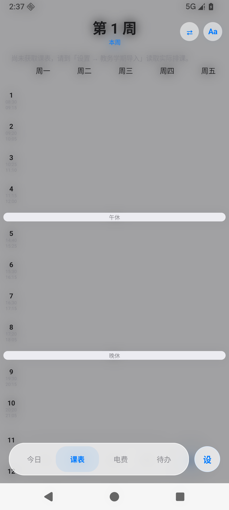

# 广科课程表

**整学期课表 · 学期成绩 · 宿舍电量 · 学习通与待办 · 九款桌面小组件**

面向广东科技学院学生的 Android 校园工具，把上课安排、学习事项和宿舍用电放在一起。使用学校统一身份认证，无需额外注册应用账号；校园数据由 App **本机直连**学校系统及完美校园，不经开发者服务器中转，无遥测。

适用于 **Android 13 及以上**，当前处于 Alpha 测试阶段。

<details>
<summary>早期版本界面截图（当前版本采用 CZeroX 界面与学校统一登录）</summary>

<p align="center">
  
  
  
</p>

</details>

## 功能

- **整学期课表导入**：登录统一身份认证后直接读取正方教务系统，按每门课**实际周次**保存，支持分段周（`1-8周`、`14-17周`）、单双周、独立调课。导入后保存在本机，可选 12 小时自动同步
- **学校统一登录**：默认在学校网页完成认证，应用自动依次连接门户、教务和学习通，并分别验证连接状态；某一服务需要补充认证时，可在对应网页继续完成。旧账号/钉钉入口保留在兼容选项
- **学期成绩**：按学年、学期查询成绩、学分与绩点，点按课程查看详情；数据按教务原文展示，刷新失败时保留该学期上次的完整查询结果
- **宿舍电量**：直连完美校园，查看剩余电量、近 7 日用电与电量走势，支持低电量/掉电预警。提供手动、均衡、低电量关注和自定间隔预设，按余量与近期用量调整查询节奏；未绑定宿舍或选择手动模式时，不运行电量后台任务。可用天数仅作粗估，同类预警 12 小时冷却
- **电量历史日历**：按日查看本机记录的剩余电量、当日变化与采样明细，最多保留近 30 天；记录从本机采样开始积累，不代表完整历史账单
- **学校通知**：按门户、教务处、官网来源手动刷新；切换来源复用缓存、刷新失败保留上次结果。教务处公开公告无需门户登录
- **通知 AI 总结**：自行配置 OpenAI 兼容服务后，将最多 15 条公告**标题**整理成分类要点；标题会发送至所配置的服务，具体内容与时间安排请查看公告原文
- **上课勿扰**：在「设置 → 课程提醒」授权并开启，按本机课表上课启用、下课退出，允许闹钟；支持通知中的单次勿扰与取消本次。使用独立系统规则，保留手动勿扰和其他应用规则；未授予精确闹钟权限时边界切换可能延迟
- **学习通**：集中查看课程/任务进度并同步作业；学校统一登录自动串联学习通，备用登录仍可使用。课程与作业分别检查实际连接与同步结果，单课失败隔离；连接帮助与详细诊断折叠展示
- **待办与通知收集**：记录日常待办；手动开启开关并授予通知使用权后，可将学习通新收到的明确作业、待提交任务或考试通知加入待办。仅处理新通知，未推送或缺少具体事项时不会生成待办，截止时间以原通知为准
- **身份隐私**：设置和个人信息默认遮罩姓名、学号，点按可展开；登录有效状态以在线身份校验为准
- **桌面个性化**：默认人物图标；可自定名称、选择图片并添加桌面快捷方式。安装标识固定为 `cn.edu.gdust.suiren`，与桌面显示独立
- **生日彩蛋**：从已认证教务的个人信息查询入口尝试读取出生日期，仅保存月日，生日当天显示一次祝福贺图；未取得明确日期则不触发，退出账号清除
- **学期日期滚轮**：学期设置与网页导入共用年／月／日选择，自动处理月底与闰年，确认第一周周一；学期设置可恢复跟随学校校历
- **桌面小组件 ×9**：课表（今日条子 4×2 / 下一节 2×2 / 周进度 1×2）、宿舍电量（走势与七天/半月切换 4×2 / 大字与迷你走势 2×2 / 竖条 1×2）、待办（列表 4×2 / 概览 2×2 / 计数 1×2）。实底卡片、大字读数，按尺寸与系统字号调整信息量；App 内预览共用真实桌面布局，小组件读取本机缓存，不独立发起网络查询
- **CZeroX 界面**：实底卡片语言，可读性优先，App 与桌面小部件共用同一套色板与间距；组件体系基于 Miuix（Apache-2.0，部分 vendor 进源码）。早期版本曾移植 [NexioSchedule](https://github.com/HaoZai000/NexioSchedule) 的页面与玻璃底栏，CZeroX 改版已移除全部玻璃实现，移植记录保留在 [NOTICE.md](NOTICE.md)
- **备份与个性化设置**：通过系统文件选择器导出、恢复课表、校历、待办、电量采样、部分偏好及宿舍电量绑定信息；支持莫奈动态取色、课表壁纸（模糊/压暗可调）、卡片字号/高度/圆角/对齐/文字颜色调整，点按课程卡可看详情

## 隐私

- 门户登录凭证和直连教务 Cookie 存本机**加密存储**，网页会话由应用 WebView 保存；密码与一次性 CAS 票据不落盘。生日只保存月日，不保存出生年份或推算年龄
- 无自建服务器，无需额外注册应用账号，无遥测；查询和同步由设备直接访问对应数据来源
- AI 总结为可选功能，启用后会将公告标题发送至你配置的 OpenAI 兼容服务
- 备份不含学校登录凭证、密码、AI 密钥和生日月日，但**包含宿舍电量账号、房间绑定及校验信息**，请妥善保存，不要公开分享
- 卸载会清除应用内部数据；自行导出的备份文件不会随卸载删除，需自行管理

## 技术栈

Kotlin · Jetpack Compose · Material 3 · [Miuix](https://github.com/miuix-kotlin-multiplatform/miuix)（Apache-2.0，部分 vendor 进源码）· Glance · WorkManager · OkHttp/OkHttp-SSE · ZXing · [MaterialKolor](https://github.com/jordond/MaterialKolor)（MIT）

## 构建

```bash
# JDK 21 + Android SDK 37（compileSdk）/ minSdk 33（Android 13+）
./gradlew assembleDebug
```

- 产物：`app/build/outputs/apk/debug/app-debug.apk`（纯 Kotlin/Compose，无 native 依赖）
- release 签名文件不入库：自建 `signing/gdust-v2-release.jks` 与 `signing/keystore.properties`（`storePassword` / `keyAlias` / `keyPassword`），`build.gradle.kts` 检测到后自动签名
- 自 alpha.22 起，release 安装标识为 `cn.edu.gdust.suiren`，debug 构建另带 `.research` 后缀；与旧版 `com.menglimi.gdust.v2`、alpha.21 的 `cn.edu.gdust.course` 是独立应用。跨安装标识迁移前可在旧版导出备份，新版导入课表、待办和偏好；登录会话、权限、桌面小部件及快捷方式需重新配置，生日月日不进入备份。

## 数据来源

| 数据 | 来源 |
|---|---|
| 校历 / 本周课表 | 学校门户 smart-admin-api |
| 整学期课表 | 正方教务（校园网内网 / 新教务公网 / WebVPN 三入口自动尝试） |
| 学期成绩 | 正方教务成绩查询 |
| 学校公告 | 学校门户 / 教务处公开公告 / 学校官网 |
| 学习通课程 / 任务进度 / 作业 | 学习通对应站点，需有效登录会话 |
| 学习通通知待办 | 本机新收到的学习通通知，需手动授权 |
| 剩余电量 / 近 7 日用电 | 完美校园智能水电接口 |
| 电量历史日历 | 本机采样记录，最多保留近 30 天 |
| AI 总结 | 用户配置的 OpenAI 兼容服务，输入为公告标题 |

## 协议

本项目以 **[GNU AGPL-3.0](LICENSE)** 发布：可自由使用、修改与分发，衍生作品须同样以 AGPL-3.0 开源；若作为网络服务提供，也必须向使用者提供对应源码。

Copyright (C) 2026 suiren0219

历史版本曾移植 [NexioSchedule](https://github.com/HaoZai000/NexioSchedule)（AGPL-3.0）的界面实现，这些提交仍保留在 git 历史中并同样按 AGPL-3.0 提供；当前 CZeroX 界面为独立重写。第三方依赖与出处见 [NOTICE.md](NOTICE.md)。

> 本项目为个人学习项目，与广东科技学院官方无关。课表、成绩、公告及宿舍电量请以学校或对应服务的原始信息为准；应用中的缓存保存在本机，备份和可选 AI 服务的数据去向见上方隐私说明。
